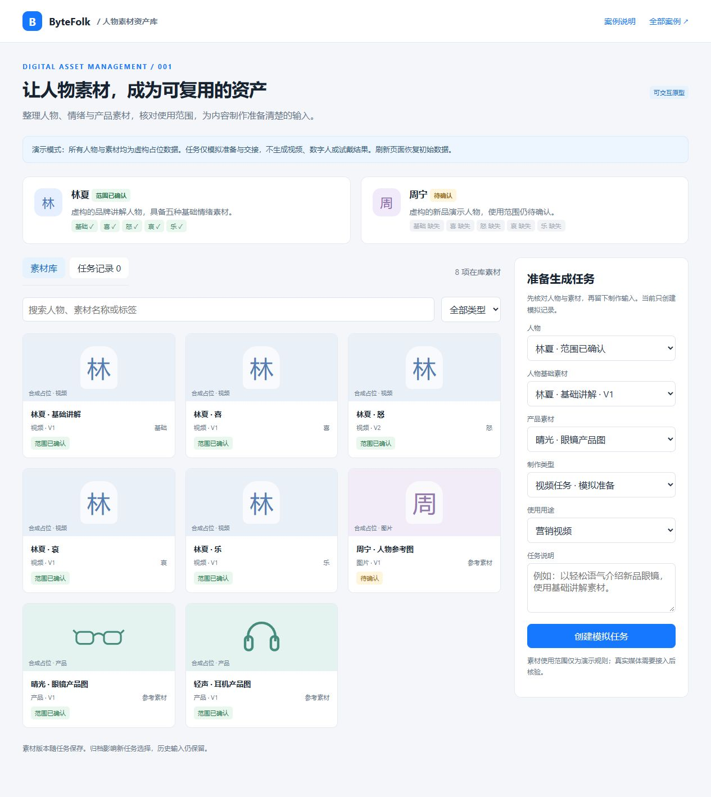

# 人物素材资产库

面向素材管理员、内容制作人员和审核人员，将人物及其情绪、动作素材和产品素材集中管理，再交给内容生成流程使用。

**状态：prototype。** 本地原型可检索素材、查看人物情绪覆盖、检查演示使用范围、建立模拟生成任务、查看任务输入和归档素材。没有接入视频生成、真人形象数字人或产品试戴服务。



## 体验

从仓库根目录启动：

```bash
npm ci
npm run check
npm run demo
```

打开 <http://127.0.0.1:4173/examples/dam/character-material-library/demo/>。

1. 查看两个人物的素材覆盖情况，搜索“林夏”或筛选“视频”。
2. 点击素材，查看版本、来源、用途和人物关联。
3. 用林夏、基础讲解素材、产品图和用途“营销视频”建立模拟任务。
4. 在任务列表查看素材版本输入快照；模拟完成后明确显示“没有生成视频”。
5. 换成待确认的人物周宁，任务会被拒绝；选择数字人或试戴任务，会显示服务尚未接入。
6. 在素材详情归档一个素材，它将从可选输入和默认素材列表消失。

页面刷新会恢复数据。页面人物、素材与商品全部虚构；卡片是代码绘制的占位视觉，没有真实照片或视频文件。本次原型不上传媒体、保存账号或调用外部服务。

## 场景价值

将“素材在哪里、能否用于本次用途、缺哪些基础素材、生成任务用了哪个版本”变成可查的业务信息。后续生成服务可以消费任务输入，而无需把工作台资产管理与模型实现绑定在一起。

详见[需求](requirements.md)、[流程](workflows.md)、[数据模型](data-model.md)、[接入说明](integrations.md)、[验收](acceptance.md)和[实际验证记录](evidence/verification.md)。
