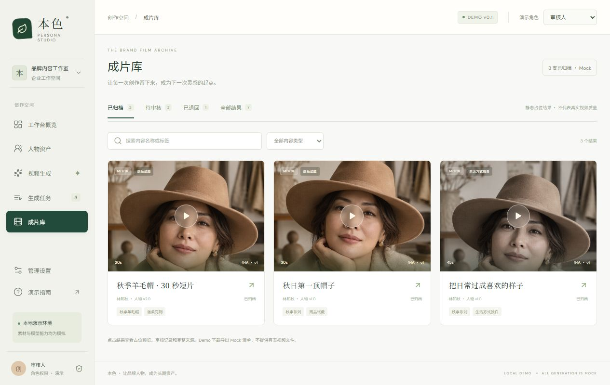

# 本色 Persona Studio · 企业数字人工作台



首个 DAM 案例。将人物、形象素材、声音资料及使用范围保存为有版本的资产，演示从内容需求到审核归档的工作流。

**状态：prototype。** 主入口为 Persona Studio 0.1.1，来自 2026-10-13 的技术交接包。所有人物、结果、费用和角色身份均为演示。小云雀真实生成、素材长期复用、克隆声线、全身剧情与真实试戴尚未验收。

## 运行

从仓库根目录执行，Node.js 22.12 或更新版本：

```bash
npm ci
npm run check
npm run demo
```

打开 <http://127.0.0.1:4173>，点击本案例“体验工作台”。统一服务先构建工作台，实际入口为 `workbench/dist/index.html`。生成的 dist 不提交，源码、静态示意图和字体许可证保留。

单独开发：`npm run persona:dev`，打开 <http://127.0.0.1:4317>。依赖由根锁文件管理，无需恢复来源包中的 macOS node_modules 或 CLI 二进制。

## 七步演示

1. 默认“内容创作者”，进入“视频生成”。
2. 输入“用品牌主理人生成 30 秒秋季帽子试戴短片，温柔克制，竖屏”，解析需求。
3. 核对推荐人物、素材与使用范围，修改脚本和参数。
4. 确认并提交，等待模拟推进，或点击“立即推进模拟”。
5. 关闭详情，切换“审核人”，再次打开任务。
6. 填写意见并通过，完成演示审核。
7. 在“成片库”查看静态占位结果、人物版本、素材快照、配置和审核；导出的是 JSON Mock 清单。

六个页面：首页、人物资产、视频生成、生成任务、成片库、管理设置。另可演示授权缺失、素材不足、范围不匹配、未配置渠道、失败复制重试和角色差异。

## 数据与重置

初始包含 3 个虚构人物、3 个渠道、6 个任务和 4 个静态结果；进行中任务会继续模拟推进。数据保存于当前浏览器 localStorage，刷新保留，多个浏览器不共享。存储键已隔离到本案例，避免读取其他工作台状态。

系统管理员在管理设置重置演示数据。角色切换不提供真实账号鉴权；素材登记仅记录元数据。

## 案例资料

- [需求与范围](requirements.md)、[流程](workflows.md)、[数据模型](data-model.md)、[集成](integrations.md)、[验收](acceptance.md)。
- [完整 PRD](workbench/docs/PRD.md)、[实现说明](workbench/docs/IMPLEMENTATION.md)、[来源环境验收](workbench/docs/ACCEPTANCE.md)。
- [归仓来源](evidence/import.md)、[本仓库验证记录](evidence/verification.md)。
- [小云雀 POC](workbench/poc/README.md)与[历史接口核查](workbench/docs/XIAOYUNQUE-API-RESEARCH.md)。当前没有真实任务或成片证据。
- [素材管理简版](demo/README.md)保留为早期教学演示，其 2 人物/8 素材 fixture 不属于 Persona Studio 初始数据。

人物示意图为来源包记录的原创 AI 虚构形象。字体遵循各自 OFL 许可证，保留于 `workbench/public/fonts/licenses/`。
